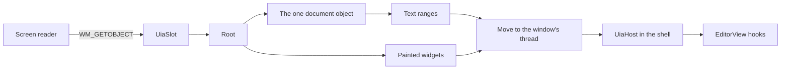

# QuickEdit UI Automation bridge

This crate shows the editor's text and the painted widgets to Windows UI Automation (UIA), the API that screen readers use. All text positions are UTF-16 units.



## What the shell must do

UIA calls a provider on its own worker thread, not on the window's thread. `src/marshal.rs` moves each host call to the window's thread, so `UiaHost` methods always run there. The shell writes no marshaling code.

1. **Keep one `qe_a11y::UiaSlot` for each window**, somewhere the window procedure can reach it, such as `Rc<UiaSlot>` in the window's state. It starts empty. Its methods take `&self`, and none holds a borrow while host code runs. So host code may call any of them from anywhere: inside an action, inside a dialog, or in WM_DESTROY. Do not put the slot itself in a `RefCell`.

2. **Add one call at the top of the window procedure.** It handles WM_GETOBJECT and the crate's own message:

   ```rust
   if let Some(answer) = slot.on_window_message(hwnd, msg, wparam, lparam, || make_host()) {
       return answer;
   }
   ```

   Other messages cost one comparison, and `make_host` runs only for UIA's first request.

3. **Write the host.** Wrap anything that is not `Send` in `UiThreadOnly`:

   ```rust
   struct Host { ui: qe_a11y::UiThreadOnly<Rc<WindowState>> }

   impl qe_a11y::UiaHost for Host {
       // The painted tree as it stands. The root is the window. Do not include the editor.
       fn widgets(&self) -> Option<Widget> { self.ui.get()?.root_widget() }
       // Run the action. See "Actions" below.
       fn action(&self, id: WidgetId, action: WidgetAction) -> windows::core::Result<()> { /* ... */ }
       // Bounds, name (the tab title), focus and a stable ID for the editor.
       fn document_widget(&self) -> Option<Widget> { /* ... */ }
       // A number for the tab on show. A range from another tab then reports "gone".
       fn view_id(&self) -> Option<u64> { /* ... */ }
       // Give the view on show, with try_borrow_mut. Return false if it is busy.
       // Afterward, apply ctx.requests as for any input, because Select and scroll use them.
       fn with_editor(&self, body: &mut dyn FnMut(&mut EditorView, &mut ViewContext)) -> bool { /* ... */ }
       // The family and the size in points, from settings and zoom.
       fn font(&self) -> Option<(String, f64)> { /* ... */ }
       // The window's DPI, because the shell tracks it. Left out, the crate asks Windows.
       fn dpi(&self) -> Option<u32> { /* ... */ }
       // True for a menu item that can be checked. See "For root" below.
       fn is_checkable(&self, id: WidgetId) -> bool { /* ... */ }
   }
   ```

   Except for `action`, these calls must not wait for disk, shape text or pump messages.

4. **Report input.** After each input batch, and after `poll_layout` changes the text, call `slot.after_input()?`. After focus moves or a dialog or menu opens or closes, call `slot.widgets_changed()?`. With no client ever, each reads one `Option`. With a provider and no listener, each makes one system call. Neither needs a timer.

5. **Close.** In WM_DESTROY, call `slot.shutdown()?`, and show its error if it gives one. It must run while the window still exists. After it, every object a client holds says `UIA_E_ELEMENTNOTAVAILABLE`, and WM_GETOBJECT falls through to `DefWindowProcW`.

`tests/support/mod.rs` is a working copy of steps 1 to 5 on a hidden window, and `tests/recipe.rs` runs it with actions that report input, close the window and act as a modal dialog.

## Actions

- **Invoke, Toggle, Expand, Collapse and Select** run from a posted message after the client's call has returned S_OK. The call checks that the control exists and is turned on. Later failures go to `UiaHost::action_failed`, and the default prints them, so a shell that wants them on screen overrides it.
- **A modal dialog** may open from these. Pump messages through the same window procedure, and hold no `RefCell` borrow of the view or the widget tree while the dialog runs. WM_GETOBJECT and read calls keep working during the dialog, and a test proves this. A borrowed view makes a call say `UIA_E_TIMEOUT`, not fail for good.
- **The action may destroy the window.** A posted action on a Close item that leads to WM_DESTROY inside the action is safe.
- **SetValue, SetRange, SelectText and Focus** run inside the call, so they can report a failure. They must not open a dialog or pump messages. If they run past the 2-second wait, the client hears `UIA_E_TIMEOUT` and the work still finishes.

UIA itself sets focus on an element before it invokes it, so a host sees a Focus action first. In a real client run, SetValue also brought a Focus action first.

## The rules a client sees

- **Line:** a visible row where a layout is on hand. Text off screen, or with no layout yet, counts by logical line, because shaping on the UI thread is not allowed. So a range's line can change as the view scrolls, and a 100 MB line off screen is one line.
- **Paragraph:** a logical line with its ending.
- **Word:** a run of word characters, or one other character, with the blank text after it. Runs come from the editor's `word_range_at`.
- **Character:** a grapheme cluster, by the table in `src/clusters.rs`. See the gaps below.
- **Format and Page:** the whole document, because plain text has one format and no pages.
- **Move:** an empty range stays empty, and a range with text stays one unit long. A move makes at least 64 steps, then stops at 8 ms and returns how far it got, as UIA allows. A range with text moves to the very end only by line or paragraph, onto a final empty line. It then stands there as an empty range. That rule is from memory of what Edit and RichEdit do.
- **GetText:** at most `GET_TEXT_CAP` units (1,048,576), whatever the limit. **A whole-file read of a huge file cannot be served in one call, and `GetText(-1)` shortens silently: the client gets the first part, with no sign that more exists.** A client reads on with a later range. A limit that ends inside a surrogate pair stops before the pair. If memory runs out part way, the answer is the part that was read.
- **FindText:** the search runs on the calling UIA thread on a snapshot, so the window's thread is held only long enough to hand it over, and one call gets the answer. It costs the text's length plus the query's length, not their product. It stops at `FIND_PATIENCE` (15 seconds) and then says `UIA_E_TIMEOUT` once, rather than claim text is absent. UIA's default transaction timeout is 20 seconds, from memory. No match is a real null.
- **A direct FindText on the window's own thread:** UIA does not do this. It reads only text in memory, up to 64 KiB, and otherwise says `UIA_E_TIMEOUT`.
- **Not yet:** text not in memory, a busy window or a borrowed view says `UIA_E_TIMEOUT`, on every call that needs them. A page read starts by itself. While a mapped file's index grows, DocumentRange covers the known part. A window that stays busy for 2 seconds makes a call say the same, and the work either never runs or finishes with nobody listening.
- **Stale:** a range from another tab or document, or older than the editor's 4,096-change log, says `UIA_E_ELEMENTNOTAVAILABLE`. Within those limits a range follows edits and undo. A position inside replaced text goes to where that text began.
- **Rectangles:** only text on screen has them, clipped to the text area. A range off screen, or with no layout yet, gives an empty list.
- **RangeFromPoint:** a point inside the document's box gets the nearest text, even in a margin or below the text. A point outside the box is `E_INVALIDARG`.
- **Read-only:** `IsReadOnly` is true, and the document offers Value with `IsReadOnly` true and `SetValue` refused. Value stops at the same cap as GetText. An editable document offers no Value.
- **Events:** at most one text change and one selection change per `after_input`. UIA has no caret event, so a caret move raises the selection change. The first batch after a client starts listening always raises both, even if nothing changed.

## For root

1. **`WidgetStates` needs one new field:** `pub checkable: bool`, "this item can be checked, whether or not it is now". Set it in `qe-ui/src/menu.rs`. Until then, the shell answers `UiaHost::is_checkable`. After it, `is_checkable` in the host is one line: `widget.states.checkable`.
2. **Grapheme stops:** add to `crates/qe-editor/src/hooks.rs`:

   ```rust
   pub fn caret_stop_after(&mut self, byte: ByteOffset) -> Result<Option<ByteOffset>, LookupError> {
       self.with_stops(|s| s.after(byte.0)).map(|o| o.map(ByteOffset))
   }
   pub fn caret_stop_before(&mut self, byte: ByteOffset) -> Result<Option<ByteOffset>, LookupError> {
       self.with_stops(|s| s.before(byte.0)).map(|o| o.map(ByteOffset))
   }
   ```

   `src/text.rs` then calls them through `TextDoc`, in place of `src/clusters.rs`. These are proposed and not compiled.
3. **ScrollIntoView:** add `EditorView::reveal_range(range, align_top, ctx)`.

## Known gaps

- **Grapheme stops.** The rule here is not the editor's. It differs from `unicode-segmentation` 1.12 on 0.032% of 24.5 million tested pairs, mostly rare and historic scripts. Emoji, flags, ZWJ, keycaps, CRLF, Hangul, combining marks and Indic conjuncts matched in the sequences tested.
- **A run of flags** stays paired in both directions up to `FLAG_RUN_LIMIT`, which is 65,536 UTF-16 units, or 16,384 flags. Past that, forward and backward stops can differ.
- **A cluster longer than 2,048 units** ends at the window, as in the editor, so forward and backward stops can differ inside it. A test case had 3,000 combining marks on one letter.
- **ScrollIntoView** keeps the selection, but places the text by estimate, so on wrapped text it can land off by the difference in row counts.
- **A text field** gives the whole field's box for any range, and no RangeFromPoint, because `Widget` does not say where its characters are.
- **RangeValue** reports a step of 1, because `WidgetRange` has no step.
- **Property change events** are not raised for toggles, values or expanded states. Focus and structure events are.
- **Focus events cannot reach a real client from a hidden window.** UIA gives a focus handler only the real keyboard focus, and it refuses a focus handler on one element. The tests check that the event was raised without error. Root checks that a client hears it, in a visible window.
- **Null results** rely on the caller starting the out pointer at null, because the generated `windows` glue leaves it alone. UIA does this, and the real client tests check it.
- **Out of memory:** GetText and Value return `E_OUTOFMEMORY` when Windows cannot make the string. Rust's own allocations still end the app, as everywhere in this workspace.
- **Duplicate widget IDs** are not checked. `find_widget` takes the first match.

## Tests

Run these with `CARGO_PROFILE_DEV_DEBUG=0` and `CARGO_INCREMENTAL=0` set:

```
cargo test -p qe-a11y --locked
cargo clippy -p qe-a11y --locked --tests -- -D warnings
```

- `tests/real_client.rs`, `tests/real_events.rs` and `tests/recipe.rs` run a real IUIAutomation client against a hidden window, on another thread or in another process.
- `tests/com.rs`, `tests/widgets.rs`, `tests/mapped.rs`, `tests/threads.rs`, `tests/busy.rs`, `tests/events.rs` and `tests/review.rs` call COM directly.
- `tests/model.rs` runs seeded random moves and edits against a plain model.
- `tests/measure.rs` and `tests/measure_key.rs` write real 512 MiB and 1 GiB files and are run by name, in release:

```
cargo test -p qe-a11y --release --locked --test measure --test measure_key -- --ignored --nocapture --test-threads=1
```

Several test threads with UIA windows at once in one process make UIA fail with E_FAIL or an empty tree, and the cause was not found. The tests with a real client take turns inside one test program. The app has one UI thread, and a test covers two windows on one thread.

## Measurements

These ran on 2026-11-02 on a PC with other builds running, in a release build with `CARGO_PROFILE_RELEASE_LTO=off`, `CODEGEN_UNITS=16` and `STRIP=none`. The app's own fat LTO build was not measured. Each call ran on the window's thread, as UIA's marshaled call does. Times are medians, with the worst in brackets, in milliseconds.

| Call | 512 MiB in memory | 512 MiB mapped | 1 GiB mapped |
| --- | --- | --- | --- |
| DocumentRange | 0.0004 (0.0005) | 0.0004 (0.0014) | 0.0007 (0.0038) |
| GetSelection | 0.0004 (0.0024) | 0.0005 (0.0036) | 0.0008 (0.0036) |
| GetText(200), middle | 0.0038 (0.0064) | 0.0745 (0.1166) | 0.1172 (0.6596) |
| GetText(-1), whole document, capped | 3.57 (4.80) | 0.69 (2.50) | 1.70 (5.36) |
| Move, character | 0.0193 (0.0463) | 0.2822 (0.5131) | 0.3904 (4.91) |
| Move, word | 0.2859 (0.3845) | 0.9966 (1.52) | 0.7821 (3.39) |
| Move, line | 0.0260 (0.0386) | 0.3775 (0.4948) | 0.5198 (0.7194) |
| Move, huge character count | 8.01 (8.03) | 8.03 (8.06) | 8.04 (17.27) |
| GetBoundingRectangles, whole document | 0.0255 (0.0772) | 0.1005 (0.1637) | 0.1404 (0.4278) |

FindText runs on the UIA thread, so each row is one call from another thread with the window's messages running. The second number is the longest the window's message loop was held up during that call.

| FindText, one call | 512 MiB in memory | 512 MiB mapped | 1 GiB mapped |
| --- | --- | --- | --- |
| Far, exact case | 96.2 ms, held up 0.045 ms | 596.9 ms, held up 0.065 ms | 1,227.0 ms, held up 0.034 ms |
| Far, ignoring case | 2,335.9 ms, held up 2.246 ms | 2,838.7 ms, held up 1.130 ms | 5,083.1 ms, held up 0.395 ms |
| Absent, exact case | 78.6 ms, held up 0.073 ms | 838.6 ms, held up 1.505 ms | 1,241.2 ms, held up 0.076 ms |
| Absent, ignoring case | 2,533.8 ms, held up 0.076 ms | 3,214.1 ms, held up 0.476 ms | 4,884.2 ms, held up 1.393 ms |

So 15 seconds covers about 3 GiB ignoring case on this PC while it is loaded, and a bigger file fails honestly once.

- **Over a frame:** one huge-count move on the 1 GiB file took 17.27 ms, while other builds ran.
- **Mapped rows** may include "not yet" answers from pages out of memory: 34 across the run.
- **While a 1 GiB file indexed:** 569 calls gave text from the known part, and the worst took 3.545 ms.
- **A key with no client:** 241.2 microseconds with the check, 241.0 without, which is no difference above noise. The check takes 1.8 ns when told no client listens. `UiaClientsAreListening` takes 3.9 ns.
- **That PC said a client was listening** on all 1,000,000 calls, so the real "no" path did not run in this timing. A test tells the check "no", and with an empty slot nothing runs at all.
- **Real client round trip, same process:** GetText(200) 1.520 ms, Move by line 1.537 ms. The test's message loop sleeps 1 ms between pumps, so the real loop should be faster. This was not measured in the app.
