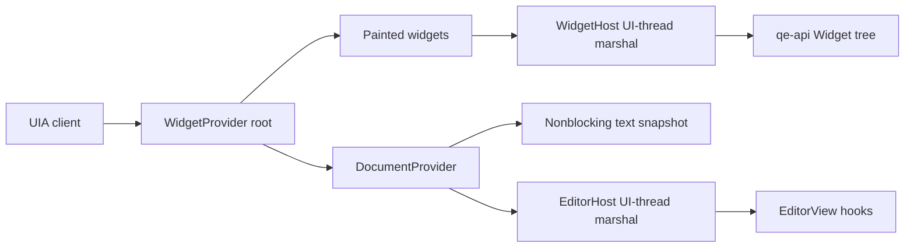

# QuickEdit UI Automation bridge

This crate exposes an editor document and the painted `Widget` tree to Windows UI Automation (UIA), the screen reader API. The root widget can place a document as its last child. All text positions are UTF-16 code units.

## Shell wiring

1. In `WM_GETOBJECT`, call `widgets::wm_getobject(hwnd, wparam, lparam, || WidgetProvider::new(host))`. Return its `LRESULT` when it is `Some`; otherwise call `DefWindowProcW`. The factory does not run unless `lparam` is `UiaRootObjectId` (-25). Keep the `WidgetHost` alive while the window exists.
2. Implement `WidgetHost::widgets` by marshaling to the UI thread and returning the latest `qe_api::Widget` tree. The root bounds must cover the window. Give each window a stable `window_id`; return the screen origin in physical pixels and the DPI scale as pixels per device-independent pixel. Implement `action` by sending the requested widget command to the UI thread. Do not perform text layout or disk reads in these calls.
3. Create `DocumentProvider::from_editor(view)` on the UI thread when the provider is first requested. Keep it in the `WidgetHost`; return it from `document_provider`. Return a `document_widget` with the editor's bounds, name, focus state and a stable `WidgetId`. Call `set_font` with the actual family and point size after creation and after font or zoom changes. Call `refresh_from_editor` after each edit, read-only change, or document replacement. A mapped file whose index is incomplete may make `from_editor` return `NotYetKnown`; create `DocumentProvider::new(TextModel::new(view.worker_snapshot()), TextRange::new(0, 0), !view.can_edit())` and refresh it when the index progresses.
4. Implement `EditorHost` with a synchronous marshal to the UI thread. Convert offsets with `EditorView::byte_to_utf16` and `utf16_to_byte`. Use `visible_range`, `byte_at_point`, and `range_rects` only from layouts already on hand. Convert rectangles from window device-independent pixels to screen physical pixels. Return a UIA error when a lookup says `NotYetKnown` or `NotLaidOut`. `select` calls `run_host(HostCommand::Select { range, reveal: true })`. Keep the actual selection in the editor; `DocumentProvider::set_selection` only updates the copy reported to a client.
5. After a group of editor actions, call `DocumentProvider::raise_editor_events(&mut tracker, view)`. It checks `UiaClientsAreListening` before reading the change log. After widget focus changes, call `WidgetProvider::raise_focus_changed`. Neither needs an idle timer.

## Current limits

- `GetText(-1)` stops after 65,536 UTF-16 units. A client can request a smaller range to read later text. `FindText` searches at most 65,536 UTF-16 units and returns `UIA_E_TIMEOUT` for a longer range; the call does not claim that the text is absent.
- Read-only documents expose `IValueProvider` with `IsReadOnly=true`. Its `Value` method returns full text only through 65,536 UTF-16 units. Editable documents expose their text pattern and do not expose a Value pattern, because this crate has no full-document edit command.
- UIA Character movement and expansion need the editor's grapheme-stop operation as a public hook. `qe-editor` currently keeps `Stops` private. The COM methods forward Word, Line, Paragraph, Page, Format, and Character units to `EditorHost`; the shell must implement them before those calls work. Line must mean a visible wrapped row when layout exists. There is no synchronous shaping path.
- `ScrollIntoView` is routed through `EditorHost`, but the editor has no public scroll-to-range hook that keeps the selection. The shell must wait for that hook or return an error.
- `ITextRangeProvider::FindText` returns an error for no match because the generated `windows` trait requires a non-null return type; UIA normally expects a null pointer with `S_OK`. Unsupported pattern queries have the same limitation. This needs a raw nullable COM vtable before an Accessibility Insights pass.
- `GetEnclosingElement` on a text range returns the document provider's own COM object, while the widget root exposes a document child with a separate COM identity. A unified provider identity is needed for a strict tree check.
- Widget text field `selection` is not exposed as a text pattern. `RangeValue` reports a fixed step of 1 because `WidgetRange` has no step field.

Run `CARGO_PROFILE_DEV_DEBUG=0 CARGO_INCREMENTAL=0 cargo test -p qe-a11y --locked` in a shell that supports those environment assignments. On PowerShell, set the two environment variables with `$env:` first.
