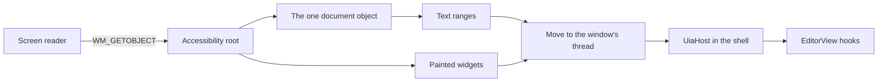

# QuickEdit UI Automation bridge

This crate shows the editor's text and the painted widgets to Windows UI Automation (UIA), the API that screen readers use. All text positions are UTF-16 units.



## What the shell must do

UIA calls a provider on its own worker thread, not on the window's thread. `src/marshal.rs` moves each host call to the window's thread with a sent message, so `UiaHost` methods always run there. The shell does not write any marshaling code.

1. **Keep a slot for each window.** Add `accessibility: RefCell<Option<qe_a11y::Accessibility>>` to the window's state. It stays `None` until a client asks.

2. **Add one call at the top of the window procedure.** It handles WM_GETOBJECT and the host-call message:

   ```rust
   if let Some(answer) = qe_a11y::on_window_message(&mut slot, hwnd, msg, wparam, lparam, || make_host()) {
       return answer;
   }
   ```

   Use `try_borrow_mut` on the slot. If it is borrowed, fall through to `DefWindowProcW`. Other messages cost one comparison, and `make_host` runs only for UIA's first request.

3. **Write the host.** Wrap anything that is not `Send` in `UiThreadOnly`:

   ```rust
   struct Host { ui: qe_a11y::UiThreadOnly<Rc<WindowState>> }

   impl qe_a11y::UiaHost for Host {
       // The painted tree as it stands. The root is the window. Do not include the editor.
       fn widgets(&self) -> Option<Widget> { self.ui.get()?.root_widget() }
       // Run the action. A popup, a toggle or a text field selection comes through here too.
       fn action(&self, id: WidgetId, action: WidgetAction) -> windows::core::Result<()> { /* ... */ }
       // Bounds, name (the tab title), focus and a stable ID for the editor.
       fn document_widget(&self) -> Option<Widget> { /* ... */ }
       // A number for the tab on show. A range from another tab then reports "gone".
       fn view_id(&self) -> Option<u64> { /* ... */ }
       // Give the view on show, with try_borrow_mut. Return false if it is busy.
       // Afterward, apply ctx.requests as for any input, because Select and scroll use them.
       fn with_editor(&self, body: &mut dyn FnMut(&mut EditorView, &mut ViewContext)) -> bool { /* ... */ }
       // The family and the size in points, from settings and zoom.
       fn font(&self) -> Option<(String, f64)> { /* ... */ }
   }
   ```

   Do not wait for disk or shape text in these calls.

4. **Report input.** After each input batch, and after `poll_layout` changes the text:

   ```rust
   if let Some(ui) = &*slot.borrow() { ui.after_input()?; }
   ```

   After focus moves or a dialog or menu opens or closes, call `ui.widgets_changed()?`. With no client listening, each makes one system call and reads nothing. Neither needs a timer.

5. **Close.** In WM_DESTROY, call `ui.shutdown()?`, and show its error if it gives one. It must run while the window still exists. After it, every object a client holds says `UIA_E_ELEMENTNOTAVAILABLE`.

`tests/support/mod.rs` is a working copy of steps 1 to 5 on a hidden window.

## The rules a client sees

- **Line:** a visible row where a layout is on hand. Text off screen, or with no layout yet, counts by logical line, because shaping on the UI thread is not allowed. So a range's line can change as the view scrolls.
- **Paragraph:** a logical line with its ending.
- **Word:** a run of word characters, or one other character, with the blank text after it. Runs come from the editor's `word_range_at`.
- **Character:** a grapheme cluster, by the table in `src/clusters.rs`. See the gap below.
- **Format and Page:** the whole document, because plain text has one format and no pages.
- **Move:** an empty range stays empty, and a range with text stays one unit long. A range with text will not move to the very end, because no unit starts there. A move makes at least 64 steps, then stops at 8 ms and returns how far it got, as UIA allows.
- **GetText:** at most `GET_TEXT_CAP` units (1,048,576) whatever the limit, so a call with no limit cannot hang the window. A client reads on with a later range. A limit that ends inside a surrogate pair stops before the pair. If memory runs out part way, the answer is the part that was read.
- **FindText:** up to 65,536 units run in the call. A longer range runs on a worker with a snapshot, and the call waits at most 6 ms. While the worker runs, the call says `UIA_E_TIMEOUT`, and the same call later gets the answer. A new search stops the old one. No match is a real null.
- **Not yet:** text that is not in memory, a busy window or a borrowed view says `UIA_E_TIMEOUT`, and a page read starts by itself. While a mapped file's index grows, DocumentRange covers the known part.
- **Stale:** a range from another tab or document, or older than the editor's 4,096-change log, says `UIA_E_ELEMENTNOTAVAILABLE`. Within those limits a range follows edits and undo. A position inside replaced text goes to where that text began.
- **Rectangles:** only text on screen has them, clipped to the text area. A range off screen, or with no layout yet, gives an empty list.
- **Read-only:** `IsReadOnly` is true, and the document offers Value with `IsReadOnly` true and `SetValue` refused. Value stops at the same cap as GetText. An editable document offers no Value.
- **Events:** at most one text change and one selection change per `after_input`. UIA has no caret event, so a caret move raises the selection change. The first batch after a client starts listening always raises both, even if nothing changed.

## Known gaps

- **Grapheme stops.** The rule here is not the editor's. It differs from `unicode-segmentation` 1.12 on 0.032% of 24.5 million tested pairs, mostly rare and historic scripts. Emoji, flags, ZWJ, keycaps, CRLF, Hangul and combining marks matched in the same comparison. The exact hook for root is in the report.
- **ScrollIntoView** keeps the selection, but it places the text by estimate, because no hook scrolls to a byte. On wrapped text it can land off by the difference in row counts.
- **A text field** gives the whole field's box for any range, and no RangeFromPoint, because `Widget` does not say where its characters are.
- **RangeValue** reports a step of 1, because `WidgetRange` has no step.
- **Property change events** are not raised for toggles, values or expanded states. Focus and structure events are.
- **Null results** rely on the caller starting the out pointer at null, because the generated `windows` glue leaves it alone. UIA does this, and the real client tests check it.

## Tests

Run these with `CARGO_PROFILE_DEV_DEBUG=0` and `CARGO_INCREMENTAL=0` set:

```
cargo test -p qe-a11y --locked
cargo clippy -p qe-a11y --locked --tests -- -D warnings
```

- `tests/real_client.rs` runs a real IUIAutomation client against a hidden window, on another thread and in another process.
- `tests/com.rs`, `tests/widgets.rs`, `tests/mapped.rs`, `tests/threads.rs` and `tests/events.rs` call COM directly.
- `tests/model.rs` runs seeded random moves and edits against a plain model.
- `tests/measure.rs` writes real 512 MiB and 1 GiB files and is run by name, in release:

```
cargo test -p qe-a11y --release --locked --test measure -- --ignored --nocapture --test-threads=1
```

Several test threads with UIA windows at once in one process make UIA fail with E_FAIL or an empty tree, so the real client tests take turns. The app has one UI thread, and a test covers two windows on one thread.

## Measurements

These ran on 2026-11-02 on a PC with other builds running, in a release build with `CARGO_PROFILE_RELEASE_LTO=off`, `CODEGEN_UNITS=16` and `STRIP=none`. The app's own fat LTO build was not measured. Each call ran on the window's thread, as UIA's marshaled call does. Times are medians, with the worst in brackets, in milliseconds.

| Call | 512 MiB in memory | 512 MiB mapped | 1 GiB mapped |
| --- | --- | --- | --- |
| DocumentRange | 0.0002 (0.0008) | 0.0003 (0.0010) | 0.0003 (0.0011) |
| GetSelection | 0.0003 (0.0018) | 0.0004 (0.0021) | 0.0004 (0.0025) |
| GetText(200), middle | 0.0040 (0.0115) | 0.0744 (0.1018) | 0.0750 (0.1174) |
| GetText(-1), whole document, capped | 2.82 (4.46) | 0.70 (2.60) | 0.85 (2.44) |
| Move, character | 0.0108 (0.0360) | 0.2415 (0.4468) | 0.2796 (0.5155) |
| Move, word | 0.1641 (0.2249) | 1.04 (1.82) | 0.53 (0.73) |
| Move, line | 0.0275 (0.0417) | 0.2219 (0.2944) | 0.1311 (0.1737) |
| Move, huge character count | 8.01 (8.02) | 8.04 (14.88) | 8.04 (10.08) |
| GetBoundingRectangles, whole document | 0.0254 (0.0804) | 0.1505 (0.1934) | 0.0833 (0.1136) |
| One FindText call on a long search | 6.08 (6.24) | 6.07 (6.24) | 6.09 (36.18) |
| FindText answer, far, exact case | 71.7 total | 589.9 total | 1,174.9 total |
| FindText answer, absent, ignoring case | 1,501.7 total | 1,912.7 total | 4,683.6 total |

A mapped-file row may include "not yet" answers from pages out of memory: 32 across the run. A cap of 1,048,576 units costs 0.7 to 2.8 ms, which leaves room inside a 16 ms frame. Three FindText calls on the 1 GiB file went over a frame: 27, 34 and 36 ms, while other builds ran. The call's own wait is 6 ms, so this is not proven to be the provider's cost, and it is not proven not to be.

- **While a 1 GiB file indexed:** 587 calls gave text from the known part, and the worst took 0.127 ms.
- **A key with no client:** 324.9 microseconds with the check, 326.00 without, which is no difference above noise. The check itself takes 2.7 ns when told no client listens. `UiaClientsAreListening` takes 7.0 ns.
- **That PC said a client was listening** on all 1,000,000 calls, so the real "no" path of `after_input` did not run in this timing. The test passes "no" directly, and with a slot that is `None`, nothing runs at all.
- **Real client round trip, 100,000-line file, same process:** GetText(200) 3.160 ms, Move by line 3.183 ms. The test's message loop sleeps 1 ms between pumps, so the real loop should be faster. This was not measured in the app.
