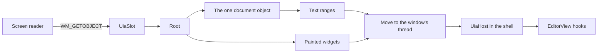

# QuickEdit UI Automation bridge

This crate shows the editor's text and the painted widgets to Windows UI Automation (UIA), the API that screen readers use. All text positions are UTF-16 units.



## What the shell must do

UIA calls a provider on its own worker thread, not on the window's thread. `src/marshal.rs` moves each host call to the window's thread, so `UiaHost` methods always run there. The shell writes no marshaling code.

1. **Keep one `qe_a11y::UiaSlot` for each window**, somewhere the window procedure can reach it, such as `Rc<UiaSlot>` in the window's state. It starts empty. Its methods take `&self`, and none holds a borrow while host code runs. So host code may call any of them from anywhere: inside an action, inside a dialog, or in WM_DESTROY. Do not put the slot itself in a `RefCell`.

   The host may hold the last reference to the state that holds the slot. Then `shutdown` frees the slot, as the very last thing it does, and `tests/closing.rs` proves that order. If the window procedure reaches its state through a raw pointer, it must clone an `Rc` of the state for the length of the message, or use nothing of the state after `shutdown` returns.

2. **Add one call at the top of the window procedure.** It handles WM_GETOBJECT and the crate's own message:

   ```rust
   if let Some(answer) = slot.on_window_message(hwnd, msg, wparam, lparam, || make_host()) {
       return answer;
   }
   ```

   Other messages cost one comparison, and `make_host` runs only for UIA's first request.

3. **Write the host.** Wrap anything that is not `Send` in `UiThreadOnly`:

   ```rust
   struct Host { ui: qe_a11y::UiThreadOnly<Rc<WindowState>> }

   impl qe_a11y::UiaHost for Host {
       // The painted tree as it stands. The root is the window. Do not include the editor.
       fn widgets(&self) -> Option<Widget> { self.ui.get()?.root_widget() }
       // Run the action. See "Actions" below.
       fn action(&self, id: WidgetId, action: WidgetAction) -> windows::core::Result<()> { /* ... */ }
       // Bounds, name (the tab title), focus and a stable ID for the editor.
       fn document_widget(&self) -> Option<Widget> { /* ... */ }
       // A number for the tab on show. A range from another tab then reports "gone".
       fn view_id(&self) -> Option<u64> { /* ... */ }
       // Give the view on show, with try_borrow_mut. Return false if it is busy.
       // Afterward, apply ctx.requests as for any input, because Select and scroll use them.
       fn with_editor(&self, body: &mut dyn FnMut(&mut EditorView, &mut ViewContext)) -> bool { /* ... */ }
       // The family and the size in points, from settings and zoom.
       fn font(&self) -> Option<(String, f64)> { /* ... */ }
       // The window's DPI, because the shell tracks it. Left out, the crate asks Windows.
       fn dpi(&self) -> Option<u32> { /* ... */ }
       // True for a menu item that can be checked. See "For root" below.
       fn is_checkable(&self, id: WidgetId) -> bool { /* ... */ }
   }
   ```

   Except for `action`, these calls must not wait for disk, shape text or pump messages.

   **Never use a plain `borrow()` or `borrow_mut()` in these calls.** They run from a sent message, which arrives whenever the window's thread is inside a call that takes sent messages. A borrow that is held across such a call would then panic, and the app runs with `panic=abort`, so the user's text is lost. Use `try_borrow`. `widgets` and `document_widget` answer `None` when busy, and the client hears `UIA_E_ELEMENTNOTAVAILABLE`. `with_editor` answers false, and the client hears `UIA_E_TIMEOUT`. So also hold no `RefCell` borrow of the widget tree across a modal loop, a cross-thread `SendMessage` or any other call that can take sent messages. `tests/second_review.rs` runs this case.

4. **Report input.** After each input batch, and after `poll_layout` changes the text, call `slot.after_input()?`. After any change a client can read in a widget, call `slot.widgets_changed()?`. See "For M14" for the list. With no client ever, each reads one `Option`. With a provider and no listener, each makes one system call. Neither needs a timer.

5. **Close.** In WM_DESTROY, call `slot.shutdown()?`, and show its error if it gives one. It must run while the window still exists. After it, every object a client holds says `UIA_E_ELEMENTNOTAVAILABLE`, and WM_GETOBJECT falls through to `DefWindowProcW`. It works inside a sent message too. It first calls `ReplyMessage(0)`, because UIA refuses to disconnect while a sender waits, so that sender then hears 0 or "gone". If it still fails, it keeps what it needs, and a later call tries again.

`tests/support/mod.rs` is a working copy of steps 1 to 5 on a hidden window, and `tests/recipe.rs` runs it with actions that report input, close the window and act as a modal dialog.

## Actions

- **Invoke, Toggle, Expand, Collapse and Select** run from a posted message after the client's call has returned S_OK. The call checks that the control exists and is turned on, and the posted message checks again just before it runs. Later failures, including a control that left or turned off in between, go to `UiaHost::action_failed`. The default prints them, so a shell that wants them on screen overrides it.
- **A modal dialog** may open from these. Pump messages through the same window procedure, and hold no `RefCell` borrow of the view or the widget tree while the dialog runs. WM_GETOBJECT and read calls keep working during the dialog, and a test proves this. A borrowed view makes a call say `UIA_E_TIMEOUT`, not fail for good.
- **The action may destroy the window.** A posted action on a Close item that leads to WM_DESTROY inside the action is safe.
- **SetValue, SetRange, SelectText and Focus** run inside the call, so they can report a failure. They must not open a dialog or pump messages. If they run past the 2-second wait, the client hears `UIA_E_TIMEOUT` and the work still finishes.

UIA itself sets focus on an element before it invokes it, so a host sees a Focus action first. In a real client run, SetValue also brought a Focus action first.

## The rules a client sees

- **Line:** with wrap on, each row on screen is its own line, from its first byte to its last, even a row only partly in view at the top or the bottom. The last row of a logical line includes the line's ending. Text off screen, or with no layout yet, counts as what is left of its logical line, because shaping on the UI thread is not allowed. So on a wrapped line that runs past both edges of the view, the text above the first row is one line, and the text below the last row is one line. A range's line can change as the view scrolls. With wrap off a logical line is always one line, and a 100 MB line is one line.
- **Paragraph:** a logical line with its ending.
- **Word:** a run of word characters, or one other character, with the blank text after it. Runs come from the editor's `word_range_at`.
- **Character:** a grapheme cluster, by the editor's caret stops. In a field, by the table in `src/clusters.rs`.
- **Format and Page:** the whole document, because plain text has one format and no pages.
- **Move:** an empty range stays empty. A range with text first goes to the start of the unit it is in, then moves, and it stays one unit long. A move makes one step, then stops at 8 ms and returns the count it reached, as UIA allows. This holds for every unit, because a move runs on the window's thread. So a client that asks for many units must read the count, and ask again from there. A count short of the request does not mean the document's edge. A count of 0 does. A range with text moves to the very end only by line or paragraph, onto a final empty line, and it then stands there as an empty range. That rule is from memory of what Edit and RichEdit do.
- **GetText:** at most `GET_TEXT_CAP` units (1,048,576), whatever the limit. **A whole-file read of a huge file cannot be served in one call, and `GetText(-1)` shortens silently: the client gets the first part, with no sign that more exists.** A client reads on with a later range. A limit that ends inside a surrogate pair stops before the pair. The read runs on the calling UIA thread on a snapshot, so it answers in one call even for text not in memory. If any part cannot be read, the answer is an error, so a short answer always means the limit or the cap. A direct call on the window's own thread reads only text in memory, and otherwise says `UIA_E_TIMEOUT`.
- **FindText:** the search runs on the calling UIA thread on a snapshot, so the window's thread is held only long enough to hand it over, and one call gets the answer. It costs the text's length plus the query's length, not their product. It stops at `FIND_PATIENCE` (5 seconds) and then says `UIA_E_TIMEOUT` once, rather than claim text is absent. The limit is short because one search makes other UIA calls to this process wait, a screen reader's among them. The window's own thread does not wait. No match is a real null, with null written over whatever the caller's out value held.
- **A direct FindText on the window's own thread:** UIA does not do this. It reads only text in memory, up to 64 KiB, and otherwise says `UIA_E_TIMEOUT`.
- **Not yet:** a busy window or a borrowed view says `UIA_E_TIMEOUT`, on every call that needs them. So does a move or a line lookup on text not in memory, and a page read starts by itself. While a mapped file's index grows, DocumentRange covers the known part. A window that stays busy for 2 seconds makes a call say the same, and the work either never runs or finishes with nobody listening.
- **Stale:** a range from another tab or document, or older than the editor's 4,096-change log, says `UIA_E_ELEMENTNOTAVAILABLE`, on every method. Within those limits a range follows edits and undo. A position inside replaced text goes to where that text began.
- **Rectangles:** only text on screen has them, clipped to the text area. An empty range has none, as UIA's contract says, so a caret range gives an empty list. A range off screen, or with no layout yet, gives an empty list too.
- **RangeFromPoint:** any point gets the nearest text, as UIA's contract says, even far outside the window. A point that is not a number is `E_INVALIDARG`. A field that has not painted answers with an estimate, by share of its width.
- **ScrollIntoView:** it puts the range's start at the top or its end at the bottom, and the selection stays. Text with a layout lands exactly. Other text is placed by estimate, so on wrapped text it can land off by the rows the estimate does not know. With wrap off, text past the view's sides scrolls sideways once it has a layout.
- **Read-only:** `IsReadOnly` is true, and the document offers Value with `IsReadOnly` true. Value stops at the same cap as GetText. An editable document offers no Value.
- **SetValue on the document:** always refused, with `UIA_E_INVALIDOPERATION`, even through a Value pattern a client kept from when the view was read-only. The host never hears it. A read-only field or range control says the same. A control that is turned off says `UIA_E_ELEMENTNOTENABLED`. Those two codes are what the .NET docs for ValuePattern.SetValue give.
- **IsOffscreen:** true for a widget or document with no size, one outside the window, or one scrolled out of a list or table that holds it. Other parents do not clip, because a popup paints outside the item that owns it.
- **IsKeyboardFocusable:** false for a control that is turned off.
- **A window destroyed with no `shutdown`:** calls say `UIA_E_ELEMENTNOTAVAILABLE`, and not "ask again".
- **Events:** at most one text change and one selection change per `after_input`. UIA has no caret event, so a caret move raises the selection change. The first batch after a client starts listening always raises both, even if nothing changed. `widgets_changed` raises focus, structure, field text, field selection, element selected, and property events for name, value, on or off, turned on or off, expanded and range value. Its first report after a client arrives only sets the baseline for these. If a raise fails, the call returns the error, and the next report or batch raises everything from that one again. So a client can hear an event twice, but it does not lose one.
- **Runtime IDs:** a widget's is its number. The document's has a fourth part, so a widget and the document can share a number.

## What `qe-app` does

- It calls `slot.widgets_changed()` after every call into the tools, the tab row or a menu, with no borrow of the app held.
- Widget IDs stay unique: `crates/qe-app/tests/commands.rs` checks the whole tree.
- A field's `Widget::char_boxes` give `GetBoundingRectangles` and `RangeFromPoint` their places. `WidgetRange::step` gives `SmallChange`, and `LargeChange` is 10 of them. `WidgetStates::checkable` and `Widget::access_key` come from `qe-ui`.
- `slot.announce(text)` raises a UIA notification, for the find count and a message that opens.
- ScrollIntoView uses `EditorView::reveal_range`, and `set_horizontal_position` when wrap is off.

**Check these in a visible window with Narrator:**

1. A focus event reaches a client, because a hidden window cannot show this.
2. Reading and magnifying still follow the caret, because an empty caret range now has no rectangle.
3. The find count and the Select Line message are spoken.

## Known gaps

- **Grapheme stops in a field.** The document uses the editor's caret stops. A field's short text still uses the table in `src/clusters.rs`. That rule differs from `unicode-segmentation` 1.12 on 0.032% of 24.5 million tested pairs, mostly rare and historic scripts.
- **A run of flags** stays paired in both directions up to `FLAG_RUN_LIMIT`, which is 65,536 UTF-16 units, or 16,384 flags. Past that, forward and backward stops can differ.
- **A cluster longer than 2,048 units** ends at the window, as in the editor, so forward and backward stops can differ inside it. A stop there is always on a character's edge, never inside a surrogate pair. A test case had 3,000 combining marks on one letter.
- **A text field that has not painted** gives its whole box for any range with text, and an estimated position for a point.
- **Focus events cannot reach a real client from a hidden window.** UIA gives a focus handler only the real keyboard focus, and it refuses a focus handler on one element. The tests check that the event was raised without error.
- **Failed calls** that return an object leave their out value alone, unless they can also answer null. Those write null first. See `src/abi.rs`. UIA's own stubs clear the value before any call.
- **Out of memory:** GetText and Value return `E_OUTOFMEMORY` when Windows cannot make the string. Strings in property answers and Rust's own allocations still end the app, as everywhere in this workspace.

## Tests

Run these with `CARGO_PROFILE_DEV_DEBUG=0` and `CARGO_INCREMENTAL=0` set:

```
cargo test -p qe-a11y --locked
cargo clippy -p qe-a11y --locked --tests -- -D warnings
```

- `tests/real_client.rs`, `tests/real_events.rs` and `tests/recipe.rs` run a real IUIAutomation client against a hidden window, on another thread or in another process.
- `tests/com.rs`, `tests/widgets.rs`, `tests/mapped.rs`, `tests/threads.rs`, `tests/busy.rs`, `tests/events.rs`, `tests/review.rs`, `tests/astra.rs`, `tests/second_review.rs` and `tests/closing.rs` call COM directly.
- `strings_a_client_passes_are_not_freed_twice_with_the_string_cache_off` in `tests/real_client.rs` runs its child with `OANOCACHE=1`, because the string cache hides a string freed twice. To check the other real-client tests the same way, set `OANOCACHE=1` for the whole run.
- `tests/model.rs` runs seeded random moves and edits against a plain model.
- `tests/move_limit.rs` tests the 8 ms limit on moves. Every test window widens that limit to 5 seconds, because those tests check exact counts, and a pause on a busy machine would stop a move short.
- `tests/measure.rs` and `tests/measure_key.rs` write real 512 MiB and 1 GiB files and are run by name, in release:

```
cargo test -p qe-a11y --release --locked --test measure --test measure_key -- --ignored --nocapture --test-threads=1
```

Several test threads with UIA windows at once in one process make UIA fail with E_FAIL or an empty tree, and the cause was not found. The tests with a real client take turns inside one test program. The app has one UI thread, and a test covers two windows on one thread.

## Measurements

These ran on 2026-11-02 on a PC with other builds running, in a release build with `CARGO_PROFILE_RELEASE_LTO=off`, `CODEGEN_UNITS=16` and `STRIP=none`. The app's own fat LTO build was not measured. Each call ran on the window's thread. Times are medians, with the worst in brackets, in milliseconds.

| Call | 512 MiB in memory | 512 MiB mapped | 1 GiB mapped |
| --- | --- | --- | --- |
| DocumentRange | 0.0003 (0.0109) | 0.0003 (0.0184) | 0.0005 (0.0084) |
| GetSelection | 0.0004 (0.0130) | 0.0004 (0.0109) | 0.0007 (0.0072) |
| GetText(200), middle | 0.0041 (0.0080) | 0.0751 (0.0967) | 0.0922 (0.1376) |
| Move, character | 0.0110 (0.0336) | 0.2272 (0.2834) | 0.2989 (0.4976) |
| Move, word | 0.2501 (0.3306) | 0.9874 (1.88) | 1.28 (1.77) |
| Move, line | 0.0267 (0.0415) | 0.2556 (0.4578) | 0.4233 (0.7219) |
| Move, huge character count | 8.01 (8.01) | 8.02 (11.41) | 8.03 (10.40) |
| GetBoundingRectangles, whole document | 0.0451 (0.0742) | 0.0817 (0.1108) | 0.0929 (0.1494) |

GetText(-1) and FindText run on the UIA thread, so each row is one call from another thread with the window's messages running. The second number is the longest that one pass of the window's message loop took during that call.

| One call | 512 MiB in memory | 512 MiB mapped | 1 GiB mapped |
| --- | --- | --- | --- |
| GetText(-1), the whole cap, from the middle | 2.4 ms, 0.018 ms | 3.9 ms, 0.018 ms | 7.8 ms, 0.045 ms |
| FindText far, exact case | 113.2 ms, 0.058 ms | 601.4 ms, 0.027 ms | 1,318.1 ms, 0.219 ms |
| FindText far, ignoring case | 2,331.9 ms, 0.068 ms | 2,288.7 ms, 0.150 ms | 4,967.9 ms, 0.161 ms |
| FindText absent, exact case | 82.0 ms, 0.051 ms | 688.6 ms, 0.148 ms | 1,989.8 ms, 10.770 ms |
| FindText absent, ignoring case | 2,304.9 ms, 0.066 ms | 2,455.4 ms, 0.267 ms | 8,651.4 ms, 36.266 ms |

These rows ran before the limit moved from 15 to 5 seconds. See "What 5 seconds covers" below for the new limit.

**What 5 seconds covers.** These are from one run on 2026-11-02 with the 5-second limit, in the same build, with other builds running on the PC. Each number is one call.

| One call | 512 MiB in memory | 512 MiB mapped | 1 GiB mapped |
| --- | --- | --- | --- |
| FindText far, exact case | 167 ms | 1,109 ms | 2,013 ms |
| FindText far, ignoring case | 4,119 ms | hit the limit | hit the limit |
| FindText absent, exact case | 197 ms | 1,203 ms | 3,006 ms |
| FindText absent, ignoring case | 3,876 ms | 5,012 ms, just inside | hit the limit |

So on this loaded PC a search ignoring case covers about 512 MiB, and an exact search covers about 1.7 GiB of a mapped file. The earlier table's lighter runs took 2.3 seconds for 512 MiB and 5.0 to 8.7 seconds for 1 GiB ignoring case, so an idle PC may reach about 1 GiB. Past that, the search fails honestly once with `UIA_E_TIMEOUT`. A client hears "ask again", and a new search starts over, so a file past the limit stays unsearched through UIA.

**Word moves with the limit.** In the same run, Move(word) with a huge count had a median of 8.07 ms in memory, 8.62 ms on 512 MiB mapped and 8.56 ms on 1 GiB mapped, down from about 63 to 120 ms worked out from the old rule's 64 steps. The worst single calls were 8.12, 58.18 and 23.84 ms. Move(character) reached 39.65 ms in the same run, so load from other builds is the likely cause of those peaks. This is not proven, and the app's own build was not measured.

- **Over a frame:** one pass of the message loop took 36.266 ms during a 1 GiB search. That pass only ran the test's pump, and the search runs on another thread, so load from other builds is the likely cause. This is not proven.
- **Repetitive ignore-case search, on the window thread:** an all-a document with a half-length run of a followed by b. 4,096 units took 0.043 ms, 8,192 took 0.081 ms, 16,384 took 0.198 ms, and 65,536 took 0.819 ms. A review measured 232 ms at 16,384 units before the linear search.
- **A long query:** 60,000 units with a 30,001-unit query took 0.795 ms ignoring case and 0.779 ms exact.
- **While a 1 GiB file indexed:** 717 calls gave text from the known part, and the worst took 0.276 ms.
- **A key with no client:** 239.6 microseconds with the check, 239.3 without, which is no difference above noise. The check takes 2.0 ns when told no client listens. `UiaClientsAreListening` takes 4.4 ns.
- **That PC said a client was listening** on all 1,000,000 calls, so the real "no" path did not run in this timing. A test tells the check "no", and with an empty slot nothing runs at all.
- **Real client round trip, same process:** GetText(200) 1.512 ms, Move by line 1.517 ms. The test's message loop sleeps 1 ms between pumps, so the real loop should be faster. This was not measured in the app.
