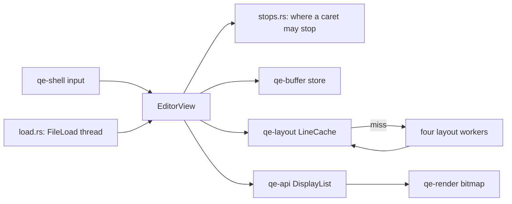

# qe-editor

The editable text area of QuickEdit for Windows, and an example window that uses it.

## The rules

- **Caret stops come from the text.** `stops.rs` answers from a short window of text around the caret. The answer is the same with or without layout, on any line length. A caret never stops inside a line ending or a grapheme cluster, and an edit that joins text moves the caret forward to the next stop.
- **Long lines first.** `place` (where is this byte) and `resolve` (which byte is here) ask about a line's segment map before anything else. When a line stops being long its map goes.
- **One path for changes.** Typing, paste, undo, redo and groups all pass through `after_change`. It moves heights, maps and queued work to the lines' new numbers.
- **One check for read-only.** `can_edit` covers Prevent Editing and mapped files, and `run_inner` asks it before any edit changes anything. A refused edit shows nothing, as the Mac's source has no message for one. It counts in `refused_edits`.
- **One timer request per event.** Only `finish` asks. A timer can fire early, because workers and the store share it, so only the clock decides when the caret blinks. An unfocused, idle view asks for none.
- **What the UI thread lays out.** It lays out a line itself only when that costs no system call: printable ASCII up to 4 KiB, in a font with equal widths. Other lines go to a worker, and an edited line keeps showing its old layout until the worker answers.
- **No layout yet.** Up, Down, Page keys and clicks then use an estimate: the line wraps every `width / cell width` characters, and x becomes a character count. The result is always a caret stop, and the remembered x stays.

## What follows AppKit

The Mac's source does not override these, so they come from what `NSTextView` does, and nobody has compared them on a Mac:

- Ctrl+Right goes to the end of the next word, and Ctrl+Left to the start of the word before.
- Up on the first row goes to the start of the text, and Down on the last row to its end.
- A double click on a space selects the run of spaces. A double click on a mark selects that mark.
- The caret hides while a selection exists.

## Running it

- `cargo run -p qe-editor --locked --example editor -- <file>` opens a window. The window appears first, and a thread loads the file.
- `--timings` prints `input to present` and `first text frame` when the window closes.
- `--bench-keys N <file>` runs in a hidden window, with no window on screen, and prints the same numbers. Build with `--release` for numbers worth reading.
- `--force-mapped` opens a small file on the read-only path. Files above 512 MiB always take it.
- `--hidden-smoke <file>` checks that the file's text reaches a frame.
- `--hidden-loop <file>` runs the real message loop in a hidden window, and exits once the loading thread has woken it.

## Tests

- `tests/behavior.rs` covers each rule and the seeded model. The model is a plain string cut into known stops, so it needs no layout to say what a key must do.
- `tests/review_cases_a.rs` and `tests/review_cases_b.rs` keep the reviewers' reproductions.
- `tests/editing.rs` is the first set, and it compares six saved pictures.
- `QE_EDITOR_DUMP_IMAGES=1` rewrites the saved pictures. Look at them before you commit them.
- `release_budget_key_work_p99_under_2_ms_on_one_megabyte` runs only in a release test build.

The example does not decode non-UTF-8 files. Decoding belongs to M14.
