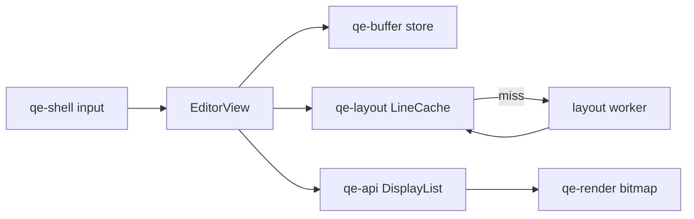

# qe-editor M9 work

`EditorView` uses `try_` store queries on the UI thread. A cache miss sends a
ticket and snapshot to one of four layout workers. The UI thread paints that line blank
until `poll_layout` inserts the result. The example asks for a 16 ms timer while
layout or drag scrolling is active, and a blink timer while focused. It cancels
the timer on blur. `poll_layout` also calls
`UndoHistory::release_memory`.

The example opens files above 512 MiB through `MappedStore`; smaller UTF-8 files
are read and built into `PieceStore`. `--hidden-smoke` creates a hidden window and
draws with `BitmapRenderer`. `--timings` prints first content paint and key
handling durations. `--force-mapped` tests a small file on the read-only path.
The six BMP files in `tests/images` were drawn by
`BitmapRenderer` at 96, 144 and 192 DPI in both themes.

This is an incomplete M9 implementation. Complete long lines use segment maps,
including a height correction when a measured segment replaces an estimate.
Full grapheme handling before a layout arrives, exact word movement, page
movement across lines that wrap, scroll pixel reuse, and measured large-file
speed budgets still need work. The example does not decode non-UTF-8 files;
file decoding belongs to M14.
