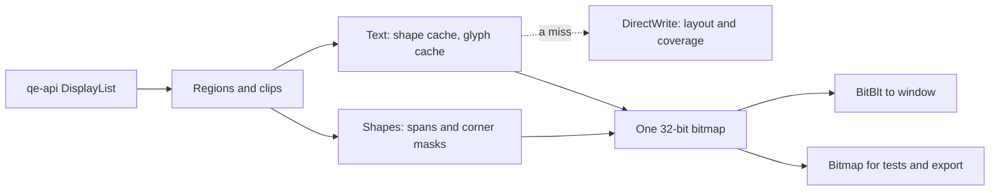

# qe-render

The renderer owns one bitmap. Shapes and text write straight to its pixels, and `present` copies changed pixels to the window with BitBlt. DirectWrite only makes glyph coverage. No GPU DLL loads.

## The bitmap

`IDWriteBitmapRenderTarget::GetMemoryDC` holds the bitmap. Microsoft's documentation of that call says the bitmap is "always a 32-bit top-down DIB", so row 0 of its pixels is the top row, whatever sign `GetObjectW` shows for the height. A test checks that text lands on its requested baseline.

## Frames and regions

- Nothing pending means nothing to do. A frame paints only what `invalidate`, `invalidate_all`, `scroll`, `resize` or `set_dpi` asked for. A new renderer starts with the whole bitmap pending.
- Pending rectangles never overlap, and there are at most 16. If two overlap they merge, because a translucent patch inside both would otherwise blend twice.
- Each `draw` in a frame paints the same regions, so a frame can hold several lists. Each list must paint an opaque background across its regions.
- `present` copies all changes since the last successful present. `present_rect` copies any rectangle with no new draw, for WM_PAINT.

## Rounding and scrolling

Edges of fills and clips, and baselines, round to the nearest device pixel by one rule (`geom::snap`). Rectangles that touch in dips touch in pixels at every scale. A rectangle with any size is at least 1 pixel. Damage from `invalidate` rounds outward.

Scrolling keeps one rule: **pixels move only by whole device pixels.** `scroll_pixels` always copies. `scroll` copies when its `dy` is a whole number of pixels. For any other `dy` it copies nothing and repaints the whole rectangle, which is always right but slower. To scroll fast at 125%, 150% and 175%, keep the scroll position on whole pixels, with `dy = pixels / scale()`.

## Text

All text takes one path, including icons, emoji layers and `render_to_bitmap`.

1. **Shape.** `GlyphRun` already has its glyphs. A `TextRun` of plain ASCII in a fixed-pitch font maps straight to glyphs. Any other `TextRun` goes through `IDWriteTextLayout` once, which gives system font fallback, shaping and direction, with the same widths as `TextMeasurer`. Results stay in a cache of at most 8 MiB, which starts over when full.
2. **Coverage.** The glyph cache is keyed by font face, device size, glyph and one of 4 subpixel positions. Colors are not in the key. It has a byte limit (32 MiB, `set_glyph_cache_limit`), and the glyphs unused for longest leave first.
3. **Blend.** `text::make_ink` follows DirectWrite's own blend: contrast for dark ink, then blending in linear light with the system's gamma. One glyph on a whole pixel matches `IDWriteBitmapRenderTarget` within 2 levels in tests. The first glyphs on a flat color build a small table, so warm text costs a few table reads per pixel.

A glyph's vertical position is a whole pixel. Its horizontal position is the nearest quarter pixel, so a glyph can differ slightly at its edges from DirectWrite's own drawing at an exact position.

`GlyphRun.offsets[n].y` is DirectWrite's `ascenderOffset`, the same value that qe-layout stores: **a positive value moves the glyph up.** `x` follows the run's direction. In a right-to-left run, `at` is the right end and glyphs draw leftward.

The color path uses COLR layers from `TranslateColorGlyphRun`, for any font that reports color glyphs. A glyph with none draws as plain text. Each layer fades on its own, so translucent emoji with overlapping layers come out somewhat stronger than true group opacity. Bitmap emoji formats are not supported.

## Font names

`TextRun.font` is a family name and nothing else. `TextRun.font_size`, `Icon.font_size` and `GlyphRun.font_em_size` are in dips. Tokens such as `Segoe Fluent Icons;10px` or `Segoe UI 9` are unknown fonts here.

Connect qe-layout's font IDs with `register_font_face(id, &qe_layout::font_face(id)?)`. `FontRegistry` and `register_font` are for fonts known by family name.

## Failures

A bad command does not stop the frame. `draw` finishes the list, then returns one `Err` that names each distinct problem once, and `draw_errors` lists them. The pixels are still valid to present.

## Saved images

`TextSettings::reference()` gives fixed text settings, so saved images do not depend on the account's ClearType setup. `render_to_bitmap` builds a new renderer on each call and is for tests and export only. Live drawing and `render_to_bitmap` run the same code; a test checks that they match exactly with either settings.

Update saved images with `QE_RENDER_UPDATE_IMAGES=1 cargo test -p qe-render --locked --test images`, then look at each changed picture.

## Speed

`cargo run -p qe-render --release --locked --example bench` measures warm frames of `GlyphRun` and `TextRun` text in both themes, shapes, and the BitBlt copy. The copy goes to a bitmap, so that no window opens; it does not measure desktop composition.
