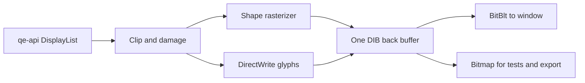

# qe-render

The renderer owns one DirectWrite bitmap target. Shapes write to its DIB bits. DirectWrite draws text into that same DIB. `present(hwnd)` copies damaged pixels with BitBlt. It does not load a GPU API in the ordinary frame path.

`invalidate(rect)` limits the next `draw` call to a changed strip. `scroll(rect, dy)` copies rows inside the DIB and asks the next `draw` call to fill the revealed strip. A cached glyph uses a 64 pixel scratch strip to the right of the visible bitmap. This keeps one DIB and speeds up warm text drawing. The cache holds at most 4,096 glyph entries; the text shape cache holds at most 2,048 strings.

M9 can give qe-layout font IDs to this crate through `FontRegistry`: implement `font(id)` to return the font family and point size, then call `register_fonts` before drawing the matching `GlyphRun` commands. No qe-api change is needed. `TextRun` uses a simple Unicode scalar to glyph lookup and a 10 point font; qe-layout must supply `GlyphRun` for shaped text.

The Windows account used for tests exposes DirectWrite's DIB bits in screen row order, although `GetObjectW` reports a positive DIB height. Tests check that text appears at its requested baseline. The DIB header does not meet the requested negative-height form.

The color path calls `IDWriteFactory2::TranslateColorGlyphRun` when a run uses Segoe UI Emoji. It draws COLR layers into the DIB. Bitmap emoji formats are still unsupported.
