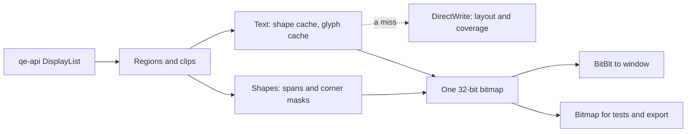

# qe-render

The renderer owns one bitmap. Shapes and text write straight to its pixels, and `present` copies changed pixels to the window with BitBlt. DirectWrite only makes glyph coverage. No GPU DLL loads.

## The bitmap

`IDWriteBitmapRenderTarget::GetMemoryDC` holds the bitmap. Microsoft's documentation of that call says the bitmap is "always a 32-bit top-down DIB", so row 0 of its pixels is the top row, whatever sign `GetObjectW` shows for the height. A test checks that text lands on its requested baseline.

## Frames and regions

- Nothing pending means nothing to do. A frame paints only what `invalidate`, `invalidate_all`, `scroll`, `resize` or `set_dpi` asked for. A new renderer starts with the whole bitmap pending.
- Pending rectangles never overlap, and there are at most 16. If two overlap they merge, because a translucent patch inside both would otherwise blend twice.
- Each `draw` in a frame paints the same regions, so a frame can hold several lists. Each list must paint an opaque background across its regions.
- Pending work stays pending until a `draw` paints it. A frame with no `draw`, or a second `begin_frame`, loses nothing.
- `present` copies all changes since the last successful present. `present_rect` copies any rectangle with no new draw, for WM_PAINT.
- A pixel that nothing has painted yet has color 0 and alpha 0. Text blends with it as black, and the result is opaque, the same as on a pixel painted black.

### The rule for ink that leaves its row

A redraw clips strictly to what was invalidated. A tall mark can reach past its row, so **invalidating only the row of an edited line leaves the old mark behind in the next row.**

When a text command changes, call `ink_bounds` on the command before the edit and on the command after it, and invalidate both rectangles. `ink_bounds` gives the rectangle that the command can ink, from the font's box and the run's advances and offsets. The next frame repaints those rectangles from the whole list, so rows that the mark reached repaint correctly too. Rectangles that overlap merge into one.

A row rectangle alone is right only for text known to stay inside its row, such as a font and size whose whole line height is the row.

## Rounding and scrolling

Edges of fills and clips, and baselines, round to the nearest device pixel by one rule (`geom::snap`). Rectangles that touch in dips touch in pixels at every scale. A rectangle with any size is at least 1 pixel. Damage from `invalidate` rounds outward.

Scrolling keeps one rule: **pixels move only by whole device pixels.** `scroll_pixels` always copies. `scroll` copies when its `dy` is exactly `pixels as f32 / scale()`. For any other `dy` it copies nothing and repaints the whole rectangle, which is always right but slower. To scroll fast at 125%, 150% and 175%, keep the scroll position on whole pixels, with `dy = pixels / scale()`.

There is no allowance around that value. One would add up to a tear: 0.802 dips at 125% is 1.0025 pixels, and 200 of those are half a pixel. Even one shift of 1.001 dips can move a shape across a rounding edge. So those shifts repaint.

Keep the scroll position as a count of pixels, and work out each list's positions from that count. Do not add `dy` up in an `f32`, because each sum rounds. In a very long document, work out `line_top - scroll_top` in `f64` and pass the difference, so that positions near the window stay exact.

## Text

All text takes one path, including icons, emoji layers and `render_to_bitmap`.

1. **Shape.** `GlyphRun` already has its glyphs. A `TextRun` of plain ASCII in a fixed-pitch font maps straight to glyphs. Any other `TextRun` goes through `IDWriteTextLayout` once, which gives system font fallback, shaping and direction, with the same widths as `TextMeasurer`. Results stay in a cache of at most 8 MiB, which starts over when full.
2. **Coverage.** The glyph cache is keyed by font face, device size, glyph and one of 4 subpixel positions. Colors are not in the key. It has a byte limit (32 MiB, `set_glyph_cache_limit`), and the glyphs unused for longest leave first.
3. **Blend.** `text::make_ink` follows DirectWrite's own blend: contrast for dark ink, then blending in linear light with the system's gamma. One glyph on a whole pixel matches `IDWriteBitmapRenderTarget` within 2 levels in tests. The first glyphs on a flat color build a small table, so warm text costs a few table reads per pixel.

A glyph's vertical position is a whole pixel. Its horizontal position is the nearest quarter pixel, so a glyph can differ slightly at its edges from DirectWrite's own drawing at an exact position.

`GlyphRun.offsets[n].y` is DirectWrite's `ascenderOffset`, the same value that qe-layout stores: **a positive value moves the glyph up.** `x` follows the run's direction. In a right-to-left run, `at` is the right end and glyphs draw leftward.

`DrawCommand::Icon` is the one exception to ClearType. It uses grayscale coverage with smoothing in both directions, on a whole pixel, in every theme and at every scale, so the stems have no color fringes and stay even. An icon's glyph has its own cache entry, apart from a ClearType glyph of the same font and size. `TextRun` and `GlyphRun` stay on ClearType.

The color path uses COLR layers from `TranslateColorGlyphRun`, for any font that reports color glyphs. A glyph with none draws as plain text. Each layer fades on its own, so translucent emoji with overlapping layers come out somewhat stronger than true group opacity. Bitmap emoji formats are not supported.

ASCII in a fixed-pitch font has no ligatures on either path, the same as qe-layout's rule. A proportional font keeps its default features in `TextRun`, which is what `TextMeasurer` measures.

Each DirectWrite rendering mode gives empty coverage past its own size, with no error. Measured on Windows build 26300, the symmetric mode stops near 700 pixels and the natural mode near 1500. So from 256 pixels up, a glyph with no coverage tries natural, then aliased. Natural has no vertical smoothing, and aliased has hard edges. A font size over 16,384 pixels, or a glyph that needs over 256 MiB, is named as too large. A glyph larger than the whole cache limit draws and is not kept, and the same goes for a string over the shape cache limit.

The system's default rendering mode asks for outlines, which an analysis cannot make, so those glyphs use the symmetric mode. In a test against DirectWrite's own drawing of a `Q` in Segoe UI, measured on one PC, no pixel is far off up to 300 pixels. At 600 to 1200 pixels, 2% to 3% of the ink's pixels differ by over 96 levels, and total ink stays within 0.3%. With a fixed natural mode, no pixel is far off up to 1200 pixels.

A run costs only its part near the clip. Each glyph is tested with its own offset, and the walk stops 8 font sizes past the clip's far edge, so a glyph offset further sideways than that is not drawn.

### Text settings

A renderer starts with the settings of the primary monitor. The window calls `refresh_text_settings_for_window(hwnd)` after WM_SETTINGCHANGE, WM_DISPLAYCHANGE and WM_DPICHANGED, and after a move that may have changed the monitor. If the settings changed, this empties the glyph cache and asks for a full repaint, and it returns `true`. If they did not, it costs one DirectWrite call and repaints nothing.

## Font names

`TextRun.font` is a family name and nothing else. `TextRun.font_size`, `Icon.font_size` and `GlyphRun.font_em_size` are in dips. Tokens such as `Segoe Fluent Icons;10px` or `Segoe UI 9` are unknown fonts here.

Connect qe-layout's font IDs with `register_font_face(id, &qe_layout::font_face(id)?)`. `FontRegistry` and `register_font` are for fonts known by family name.

## Failures

A bad command does not stop the frame. `draw` finishes the list, then returns one `Err` that names each distinct problem once, and `draw_errors` lists them. The pixels are still valid to present.

A position or size that is not a finite number skips that command and is named. A bad `PushClip` or `PushOpacity` hides what it holds. `invalidate` with a bad rectangle repaints everything and reports it from the next `draw`. `scroll` and `scroll_pixels` return the error.

If a resize changes the bitmap and then cannot find its pixels, the renderer holds no pixels and has size 0. Each `draw` and `bitmap` call then returns that error, and nothing touches memory. The next `resize` that finds the pixels ends this. A resize that fails before changing anything leaves the old bitmap in use.

## Repeatability

Within one process, the same list gives the same pixels on every thread, in every order, and from a new or a warm renderer. `tests/repeat.rs` checks this.

Across processes, DirectWrite itself is not always repeatable. Measured on Windows build 26300: `IDWriteGlyphRunAnalysis`, with no qe-render code in the path, sometimes gives Segoe UI's `A` a few different coverage values. The answer stays for the life of that process. It came from one thread as well as eight, and from runs with a lock around each glyph, so a lock does not fix it and qe-render has none. It follows quiet time: in 2 of 2 tries, the first process after 60 seconds with no process using this path got the odd answer, and the next 5 processes did not. After 30 seconds or less, 0 of 6 tries did.

So a saved-image test in a new process needs one of two things: a small allowance, such as a few values in 10,000, or a throwaway process that draws text just before it. To look for this, run `repeat_stress raw PROCESSES THREADS` from the examples, with `QE_STRESS_TEXT=A` for a quicker run.

## Saved images

`TextSettings::reference()` gives fixed text settings, so saved images do not depend on the account's ClearType setup. `render_to_bitmap` builds a new renderer on each call and is for tests and export only. Live drawing and `render_to_bitmap` run the same code; a test checks that they match exactly with either settings.

Update saved images with `QE_RENDER_UPDATE_IMAGES=1 cargo test -p qe-render --locked --test images`, then look at each changed picture.

## Speed

`cargo run -p qe-render --release --locked --example bench` measures warm frames of `GlyphRun` and `TextRun` text in both themes, emoji screens cold and warm, very large text, shapes, and the BitBlt copy. The copy goes to a bitmap, so that no window opens; it does not measure desktop composition.
